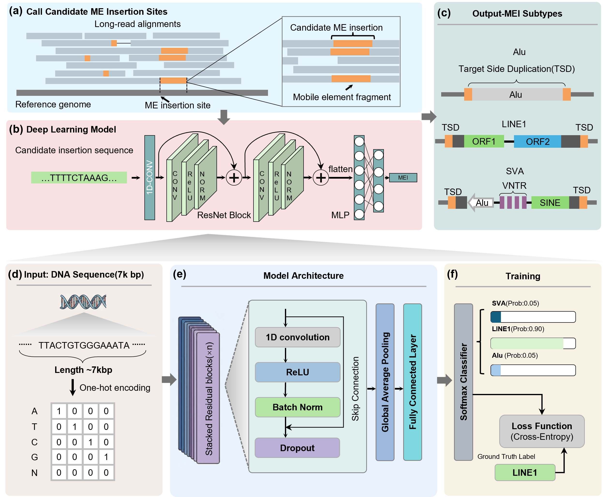

# MEIsensor (v2.0)

MEIsensor is a tool for detecting, classifying and annotating mobile element insertions (MEIs) from long-read sequencing data. It calls insertions from aligned reads, classifies each insertion as Alu, LINE1 or SVA with a trained convolutional neural network, and optionally annotates every call in the output VCF (`--annotate`).

## Overview

MEIsensor extracts split-read and inline insertion signals from a coordinate-sorted BAM, clusters them into candidate insertions, and assembles a consensus insertion sequence from the supporting reads. Each candidate is then classified by the neural network; insertions that are not classified as MEI are dropped, so the output VCF only contains Alu/LINE1/SVA calls.



## Installation

Tested on Linux with Python 3.10, PyTorch 2.7 (CUDA 12.8) and an NVIDIA GPU.

```bash
git clone https://github.com/Yudong-XJTU/MEIsensor-release.git
cd MEIsensor-release
```

With CUDA 12.8 or higher:

```bash
conda env create -f environment.yml -n MEIsensor
conda activate MEIsensor
```

For other CUDA versions, install manually and pick the PyTorch build that matches yours:

```bash
conda create -n MEIsensor python=3.10
conda activate MEIsensor
pip install torch==2.7.0 torchvision==0.22.0 torchaudio==2.7.0 --index-url https://download.pytorch.org/whl/cu128
pip install -r requirements.txt
```

Check CUDA:

```bash
python -c "import torch; print(torch.__version__, torch.version.cuda, torch.cuda.is_available())"
```

## Usage

```bash
python src/main.py -i $BAM_PATH -v $OUTPUT_PATH --reference $REF_PATH -m $MODEL_PATH -t $THREAD
```

Example:

```bash
python src/main.py \
    -i sample.hifi.minimap2.sorted.bam \
    -v sample.MEI.vcf \
    --reference GRCh38.fasta \
    -m src/trained_model/seq_classify_model.ph \
    -t 12
```

Parameters:

```text
-i BAM_PATH                       coordinate-sorted, indexed .bam of aligned long reads
-v OUTPUT_PATH                    output VCF (.vcf or bgzipped .vcf.gz)
--reference REF_PATH              reference genome the reads were aligned to
-m MODEL_PATH                     trained model, shipped at src/trained_model/seq_classify_model.ph
-t THREAD                         number of threads (default 4)
```

The reference is needed for classification: the base at each insertion site is taken from it and prepended to the ALT sequence before the model is applied. Without a reference no classified calls are written. Use the same reference the BAM was aligned against.

### Annotation

With `--annotate true` every call is annotated directly in the output VCF INFO field:

```bash
python src/main.py -i sample.hifi.minimap2.sorted.bam -v sample.MEI.vcf \
    --reference GRCh38.fasta -m src/trained_model/seq_classify_model.ph -t 12 \
    --annotate true --svan-path /path/to/SVAN --svan-resources /path/to/svan_resources
```

- **EN motif** (built-in): the L1 endonuclease cleavage consensus (5'-TTTT/AA-3') near the insertion point, supporting a TPRT origin of the insertion — INFO fields `EN_MOTIF`, `EN_STRAND`, `EN_OFFSET` (search window `--en-motif-window`, default ±25 bp).
- **SVAN** (external): full MEI annotation by [SVAN](https://github.com/REPBIO-LAB/SVAN), driven unmodified — mobile element family, insertion strand, TSD, poly(A), insertion conformation, transductions — merged into the VCF as `SVAN_*` INFO fields; SVAN's own output is additionally kept at `<output>.svan.vcf`. Requires `--svan-path` (the SVAN repository), `trf`, `bwa`, `minimap2` and `paftools.js` on the PATH, and the [SVAN resource files](https://zenodo.org/records/15229020) via `--svan-resources` (reference and consensus FASTA need `bwa index` beforehand).

## Output

The output is a standard VCF:

- ID: `MEIsensor.ALU.INS`, `MEIsensor.LINE1.INS` or `MEIsensor.SVA.INS`
- REF/ALT: reference base at the insertion point, and the reference base plus the assembled insertion sequence
- INFO: call statistics; with `--annotate true` also `EN_*` and `SVAN_*` annotation fields

## Demo

`demo/data/demo.bam` contains a small HiFi BAM extracted from HG00513 (chr3:110-113Mb). It calls 3 MEIs (1 Alu, 1 LINE1, 1 SVA), all of them true insertions that match the benchmark dataset at exact positions. Run it from the repository root:

```bash
python src/main.py -i demo/data/demo.bam -v demo.MEI.vcf \
    --reference GRCh38.fasta -m src/trained_model/seq_classify_model.ph -t 8
```

With `--annotate true` every call additionally carries SVAN annotations (a 5'-truncated transducing LINE1, a full-length SVA, and an Alu with TSD) and the EN motif. `demo/result/` holds the expected output.

On a SLURM cluster, set `REF` in `demo/run_demo.sbatch` to your reference genome (and optionally `SVAN_PATH`/`SVAN_RESOURCES` to enable annotation), then:

```bash
sbatch demo/run_demo.sbatch
```
